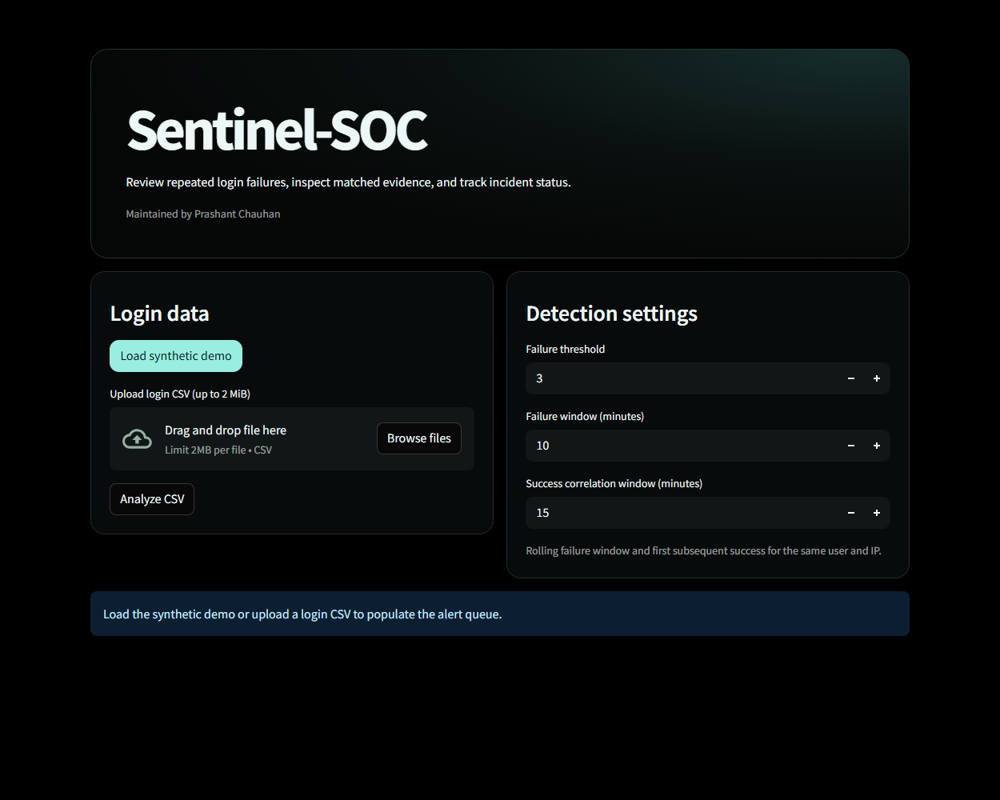
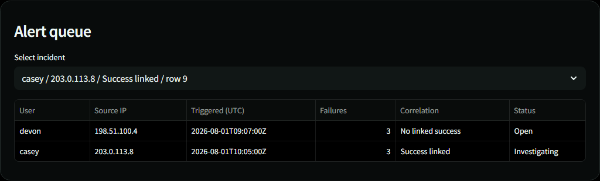
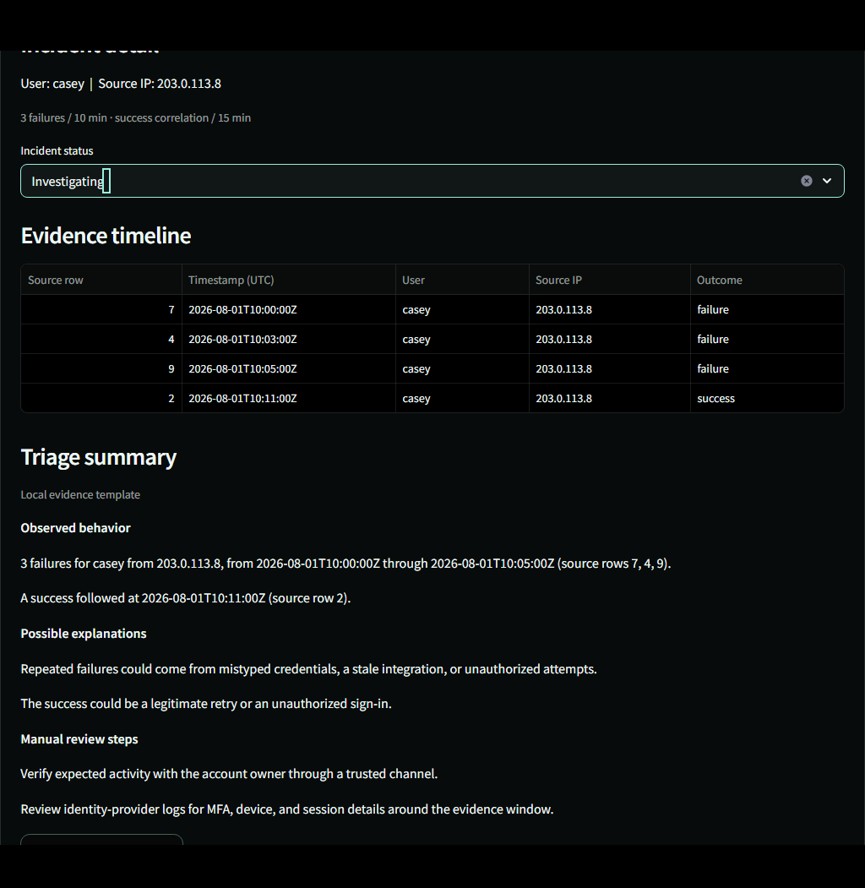

# Sentinel-SOC

Sentinel-SOC helps a junior SOC analyst review repeated sign-in failures, correlate a later success, and export the exact evidence behind a triage decision. It runs locally in Streamlit without an API key, database, or external service.

**Author and maintainer** [Prashant Chauhan](https://github.com/itsprshnt20)

**Planned repository** [itsprshnt20/Sentinel-SOC](https://github.com/itsprshnt20/Sentinel-SOC)

## Screenshots

### OLED dashboard

Load the synthetic demo or upload a CSV, then adjust the detection settings.



### Alert queue

Compare the synthetic alerts with and without a linked success.



### Incident evidence

Review Casey's matched source rows, UTC timeline, and triage summary with the incident marked Investigating.




## Features

- Import UTF-8 login CSVs, normalize timestamps, and report rejected source rows.
- Adjust the rolling failure threshold, failure window, and separate success correlation window.
- Review the alert queue, track status, and inspect the chronological timeline.
- Read a local template summary with source-row citations and export the selected incident as JSON.

## Windows setup

Open PowerShell in the project folder with 64-bit Python 3.11 installed.

```powershell
py -3.11 -m venv .venv
.\.venv\Scripts\python.exe -m pip install -r requirements.txt
.\.venv\Scripts\python.exe -m streamlit run app.py
```

Open [the local dashboard](http://127.0.0.1:8501). Installation downloads pinned packages from PyPI. Streamlit listens on loopback with usage statistics disabled. The app keeps uploads and statuses in session memory and does not send login evidence to a service.

## Two-minute demo

1. Click **Load synthetic demo** at the default settings of 3 failures, a 10-minute failure window, and a 15-minute success window. The dashboard shows 10 valid events, 0 rejected records, and 2 alerts.
2. Under **Select incident**, choose **casey / 203.0.113.8 / Success linked**. The timeline shows source rows **7, 4, 9, 2** in UTC chronological order. The success in row 2 occurs six minutes after the triggering failure. The Devon alert has three failures and no linked success.
3. Change **Incident status** to **Investigating**, switch to Devon, and return to Casey. Casey retains its status.
4. Click **Download incident JSON** and open the file. Its status is `Investigating`, `matching_row_ids` is `[7, 4, 9, 2]`, and its evidence timestamps use UTC with a trailing `Z`.
5. To try the upload path, select `samples/synthetic_logins.csv` and click **Analyze CSV**. Both paths use the same importer and detector.

## CSV schema

| Header | Accepted values |
| --- | --- |
| `timestamp` | ISO 8601 date and time with seconds, optional fractional seconds up to six digits, and optional `Z` or `±HH:MM`. Naive timestamps are interpreted as UTC. Offset timestamps are converted to UTC. |
| `user` | 1–128 printable characters after trimming. User comparison is case-sensitive. |
| `source_ip` | IPv4 or IPv6 literal with canonical normalization. Zone identifiers are unsupported. |
| `outcome` | `failure` or `success`, case-insensitive. |

Headers are trimmed, case-insensitive, and unique. Extra columns are ignored. Input is capped at 2 MiB and 20,000 records. Source row IDs are 1-based physical starting lines, so a multiline quoted record is identified by its first line. A row with an invalid value or field count is reported and skipped. Invalid CSV quoting or an oversized field stops parsing at the first unreadable record, which is reported. The preceding valid records can still be analyzed.

```csv
timestamp,user,source_ip,outcome
2026-08-01T10:00:00Z,casey,203.0.113.8,failure
2026-08-01T10:03:00Z,casey,203.0.113.8,failure
2026-08-01T10:05:00Z,casey,203.0.113.8,failure
2026-08-01T10:11:00Z,casey,203.0.113.8,success
```

## Detection rules

1. Sort by UTC timestamp, then source row ID. Group by trimmed user and canonical source IP.
2. Maintain a rolling window of unmatched failures within each group. A failure exactly one window length before the triggering failure still counts. Emit one alert when the threshold is reached, then consume its matched failures so they are not reused. Successes do not reset the failure buffer.
3. Link the earliest success for that group with a timestamp strictly later than the triggering failure and at most the configured success window later. A success exactly at the upper boundary is included. A success with a tied timestamp is excluded even if its source row is later. If successes tie, use the lowest source row ID. One success can be linked to multiple qualifying bursts.
4. The selected incident's evidence drives its timeline, deterministic text summary, and JSON. Every observed incident statement cites its matching rows. Possible explanations and review steps are hypotheses and suggested actions.

```text
Synthetic CSV or upload → Validate and normalize → Group and detect
                                                        |
                                              Alert queue and status
                                                        |
                                         Timeline, summary, JSON export
```

## Tests

```powershell
.\.venv\Scripts\python.exe -m unittest discover -s tests -v
```

Optional browser smoke check. Start the app in a separate terminal. Playwright downloads Chromium headless shell and supporting tools.

```powershell
.\.venv\Scripts\python.exe -m pip install playwright==1.65.2
.\.venv\Scripts\python.exe -m playwright install chromium --only-shell
.\.venv\Scripts\python.exe tests/browser_smoke.py
```

## Limitations

- Workflow status persists in the browser session for the same input and detection settings. There is no shared case store or cross-session recovery.
- Rules use exact user and source-IP pairs. Distributed attempts and shared-IP attribution require other evidence.
- A linked success establishes temporal correlation. Confirm device, authentication and account context before drawing a conclusion.

## GitHub handoff

**Repository description** Local Streamlit dashboard for login-alert triage with CSV validation, rule-based correlation, analyst status tracking, and incident JSON export.

**Resume bullet** Built Sentinel-SOC, a local Streamlit dashboard that validates login CSVs, correlates failures and subsequent successes, and exports source-row-cited incident evidence.

For a new empty repository, run these from the project root after signing in locally. If the target already has commits, clone it and inspect its contents before adding the audited source.

```powershell
git init -b main
git add .gitignore .streamlit/config.toml LICENSE README.md app.py triage.py requirements.txt requirements.lock.txt samples/synthetic_logins.csv tests/test_triage.py tests/browser_smoke.py docs/screenshots
git diff --cached --check
git commit -m "Add Sentinel-SOC login triage dashboard"
git remote add origin https://github.com/itsprshnt20/Sentinel-SOC.git
git push -u origin main
```

## License

[MIT License](LICENSE). Original code and synthetic samples are included. Runtime and optional test dependencies are installed separately under their own licenses.
